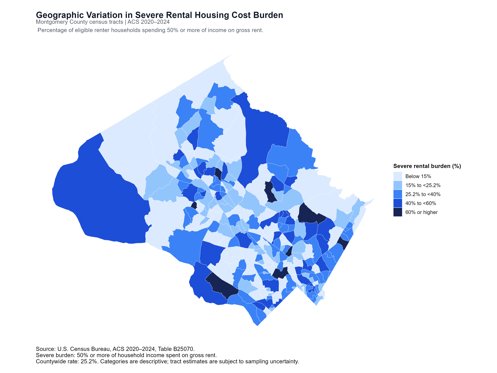
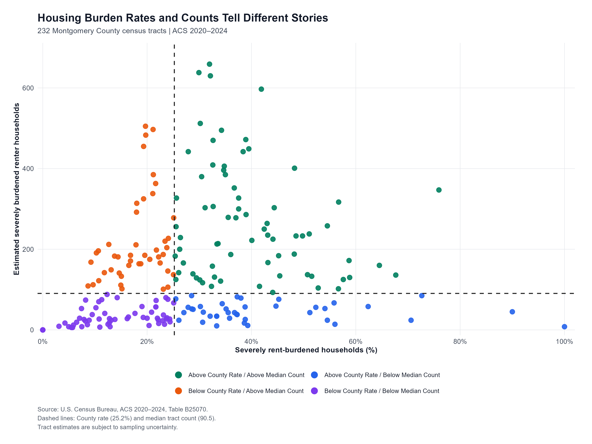

# Severe Rental Housing Cost Burden in Montgomery County, Maryland

### Geographic Patterns and Implications for Healthcare Access | ACS 2020–2024

**Author:** Anthony Benyarko  
**Tools:** R, tidyverse, tidycensus, sf, ggplot2, R Markdown  
**Data Source:** U.S. Census Bureau, American Community Survey (ACS), 2020–2024 Five-Year Estimates  
**Geographic Coverage:** Montgomery County, Maryland — 232 Census Tracts

---

## Project Overview

Housing affordability is an important social determinant of health. High housing costs may reduce the financial resources households have available for healthcare, medications, transportation, food, and other essential needs.

This project examines geographic variation in severe rental housing cost burden across 232 census tracts in Montgomery County, Maryland, using the U.S. Census Bureau's 2020–2024 American Community Survey (ACS) five-year estimates.

The analysis evaluates both the percentage of renter households experiencing severe housing cost burden and the estimated number of affected households. This dual perspective helps distinguish areas experiencing concentrated housing affordability pressures from areas containing larger numbers of affected households.

The findings are intended to support exploratory community health needs assessments, population health planning, and discussions about potential outreach and community partnerships.

**Important:** This analysis does not directly measure healthcare access, patient eligibility, or unmet medical needs.

---

## Research Question

**How does severe rental housing cost burden vary across Montgomery County census tracts, and what might these geographic differences mean for healthcare access?**

---

## Executive Summary

Countywide, an estimated **32,527 renter households (25.2%)** spend at least 50% of their household income on gross rent, among renter households with computable rent-to-income ratios.

Of the 232 census tracts analyzed:

- **111 census tracts** have severe rental housing cost burden rates above the countywide estimate.
- These 111 tracts collectively account for **64.2%** of the county's estimated severely rent-burdened households.
- **42 census tracts (18.1%)** have severe burden rates of at least 40%.
- These 42 tracts account for **20.9%** of severely rent-burdened households.
- **85 census tracts (36.6%)** have contrasting classifications when comparing severe burden rates with affected-household counts.

These findings demonstrate why both geographic concentration and the estimated number of affected households should be considered when examining housing affordability pressures.

---

## Data Source

**U.S. Census Bureau — 2020–2024 American Community Survey Five-Year Estimates**

**Table B25070:** Gross Rent as a Percentage of Household Income in the Past 12 Months.

Data were obtained from the U.S. Census Bureau and processed using R.

Source:  
https://data.census.gov/table/ACSDT5Y2024.B25070

### Geographic Coverage

- Maryland
- Montgomery County, Maryland
- 232 Montgomery County census tracts

The primary analysis focuses on the 232 census tracts.

### Definition of Severe Rental Housing Cost Burden

Severe rental housing cost burden is defined as spending **50% or more of household income on gross rent**.

The severe burden rate is calculated as:

Severe Burden Rate (%) =

(Number of renter households spending 50% or more of income on gross rent / Number of renter households with computable rent-to-income ratios) × 100

Households in the ACS **Not Computed** category were excluded from the denominator.

---

## Analytical Methods

This project uses descriptive statistical analysis and geographic visualization to examine severe rental housing cost burden.

### 1. Data Preparation

- Imported ACS Table B25070.
- Cleaned and standardized geographic identifiers.
- Restructured ACS estimates and margins of error.
- Calculated eligible renter household denominators.
- Calculated severe rental housing burden counts and rates.
- Validated geographic estimates and calculated rates.

### 2. Geographic Analysis

- Retrieved census tract geographic boundaries using `tidycensus`.
- Joined geographic boundaries with housing burden estimates.
- Created a choropleth map displaying severe burden rates.
- Classified census tracts into five descriptive burden categories.

### 3. Comparative Analysis

Compared each census tract using two measures:

1. Severe rental housing burden rate.
2. Estimated number of severely rent-burdened households.

Two reference values were used:

- Countywide severe burden rate: **25.2%**
- Median census tract affected-household count: **90.5**

Tracts were classified into four descriptive groups:

| Classification | Census Tracts |
|---|---:|
| Above County Rate / Above Median Count | 71 |
| Above County Rate / Below Median Count | 40 |
| Below County Rate / Above Median Count | 45 |
| Below County Rate / Below Median Count | 76 |
| **Total** | **232** |

These comparisons are descriptive and do not represent statistical significance testing.

### 4. Data Validation

Validation confirmed:

- All 232 census tracts had valid calculated burden rates.
- No missing severe burden estimates.
- Consistent category totals across ACS geographies.
- Matching severe burden counts and calculated rates across all 232 tracts when independently retrieved through the Census API.

---

## Data Visualizations

### Figure 1. Geographic Distribution of Severe Rental Housing Cost Burden



The choropleth map illustrates geographic variation in severe rental housing burden across Montgomery County census tracts.

Based on ACS point estimates, 42 tracts (18.1%) have severe burden rates of at least 40%, but these tracts account for only 20.9% of the county's estimated severely rent-burdened households.

### Figure 2. Housing Burden Rates and Counts Tell Different Stories



The scatterplot compares severe rental housing burden rates with the estimated number of affected households across 232 census tracts.

Of the 232 tracts, 85 (36.6%) have contrasting classifications:

- 40 tracts exceed the countywide burden rate but fall below the median affected-household count.
- 45 tracts fall below the countywide burden rate but exceed the median affected-household count.

These findings demonstrate that higher burden rates do not necessarily correspond to larger numbers of affected households.

---

## Implications for Healthcare Access

Housing affordability is an important component of economic stability and a social determinant of health.

Severe rental housing cost burden may reduce the resources available for:

- Healthcare appointments
- Prescription medications
- Transportation
- Food and nutrition
- Other essential household needs

Geographic housing affordability indicators may support:

- Community health needs assessments
- Population health planning
- Outreach planning
- Partnerships with housing and social service organizations

However, the analysis does not establish a causal relationship between housing affordability and healthcare access.

Housing burden estimates should be interpreted alongside healthcare utilization data, patient social needs screening, and local community information.

---

## Analytical Limitations

### ACS Sampling Uncertainty

ACS five-year estimates are subject to sampling uncertainty, particularly in census tracts with small renter populations.

Using an exploratory uncertainty threshold, **156 of 232 tracts (67.2%)** had relative margins of error of at least 50% for estimated severely rent-burdened household counts.

This uncertainty measure applies to household counts and not directly to calculated burden rates.

The 50% relative margin-of-error threshold is an exploratory analytical criterion rather than an official Census reliability classification.

### Temporal Limitations

The 2020–2024 ACS five-year estimates represent a multiyear period rather than current conditions.

### Geographic and Analytical Limitations

- Census tract boundaries do not necessarily correspond to healthcare service areas.
- Geographic comparisons are descriptive.
- The analysis does not establish statistically significant differences between census tracts.
- The analysis does not measure actual healthcare access barriers.
- The analysis does not establish causality.
- ACS estimates alone should not determine intervention priorities.

---

## Three Executive Takeaways

**1. Housing affordability represents a substantial community concern.**

An estimated 32,527 renter households (25.2%) experience severe rental housing cost burden in Montgomery County, potentially creating financial pressures relevant to healthcare access.

**2. Both burden rates and affected-household counts are necessary.**

Rates identify areas with concentrated housing affordability pressures, while counts indicate the estimated scale of affected households.

**3. Geographic findings can inform further assessment.**

Healthcare organizations can combine ACS indicators with patient-level social needs data, healthcare utilization information, and community partner insights to inform outreach and community health needs assessments.

---

## Project Structure

```text
Montgomery-County-Housing-Affordability-Analysis/
│
├── README.md
├── LICENSE
├── .gitignore
├── Montgomery-County-Housing-Affordability-Analysis.Rproj
│
├── R/
│   └── housing_affordability_analysis.R
│
├── data/
│   └── Public ACS source data
│
├── docs/
│   ├── Housing-Affordability-and-Healthcare-Access-Montgomery-County.Rmd
│   └── Housing-Affordability-and-Healthcare-Access-Montgomery-County.pdf
│
└── images/
    ├── montgomery_housing_burden_categorical.png
    └── housing_burden_scatterplot_final.png
```

File names should be adjusted to match the files actually included in the repository.

---

## Reproducibility

The analysis was developed in R and RStudio.

### Required R Packages

```r
install.packages(c(
  "tidyverse",
  "tidycensus",
  "sf",
  "ggplot2",
  "readr",
  "dplyr",
  "tidyr",
  "knitr",
  "rmarkdown"
))
```

### Reproducing the Analysis

1. Clone or download the repository.
2. Open the RStudio project.
3. Install the required R packages.
4. Obtain a free U.S. Census API key if needed.
5. Store the API key securely in `.Renviron` rather than the source code.
6. Run the R analysis script to process ACS estimates and generate the figures.
7. Knit the R Markdown document to produce the executive assessment.

**Security note:** Never commit Census API keys, `.Renviron`, credentials, or private organizational data to GitHub.

---

## Executive Analytical Assessment

The complete three-page executive report includes:

- Research question and executive summary
- Data and analytical methodology
- Geographic distribution map
- Rate-versus-count scatterplot
- Key findings and interpretation
- Healthcare access implications
- Analytical limitations
- Three executive takeaways

**[View the Executive Analytical Assessment (PDF)](docs/Housing-Affordability-and-Healthcare-Access-Montgomery-County.pdf)**

---

## Technical Skills Demonstrated

**Data Analytics**
- Data cleaning and preprocessing
- Descriptive statistical analysis
- Data validation and quality assurance
- ACS margin-of-error interpretation
- Comparative geographic analysis

**Programming and Visualization**
- R programming
- tidyverse and dplyr
- tidycensus and Census API integration
- sf spatial data processing
- ggplot2 visualization
- R Markdown reporting

**Healthcare and Decision Support**
- Social determinants of health
- Population health analytics
- Community health needs assessment
- Evidence-based decision support
- Executive reporting and communication

---

## Author

**Anthony Benyarko**

Data Analytics | Healthcare Analytics | Population Health | Statistical Analysis | R | Power BI

This project demonstrates the application of public data, geographic analytics, and statistical reasoning to support evidence-informed population health planning.

---

## Data Attribution

U.S. Census Bureau. (2024). *American Community Survey 2020–2024 Five-Year Estimates, Table B25070: Gross Rent as a Percentage of Household Income in the Past 12 Months.*

https://data.census.gov/table/ACSDT5Y2024.B25070
```
